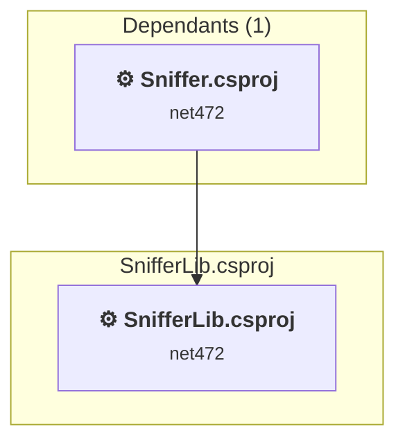

# SnifferLib\SnifferLib.csproj

[← Back to the assessment index](../../assessment.md)

## Project Info

- **Current Target Framework:** net472
- **Proposed Target Framework:** net10.0
- **SDK-style**: False
- **Project Kind:** ClassicClassLibrary
- **Dependencies**: 0
- **Dependants**: 1
- **Number of Files**: 5
- **Number of Files with Incidents**: 1
- **Lines of Code**: 456
- **Estimated LOC to modify**: 0+ (at least 0,0% of the project)

## Related Projects

**Depended on by (1)** — projects that reference this one:

- [D:\GitHub\Sniffer\Sniffer\Sniffer.csproj](../projects/Sniffer.md)

## Dependency Graph

Legend:
📦 SDK-style project
⚙️ Classic project

## API Compatibility

| Category | Count | Impact |
| :--- | :---: | :--- |
| 🔴 Binary Incompatible | 0 | High - Require code changes |
| 🟡 Source Incompatible | 0 | Medium - Needs re-compilation and potential conflicting API error fixing |
| 🔵 Behavioral change | 0 | Low - Behavioral changes that may require testing at runtime |
| ✅ Compatible | 292 |  |
| ***Total APIs Analyzed*** | ***292*** |  |

## NuGet Package Issues

| Package | Current Version | Suggested Version | Severity | Issue |
| :--- | :---: | :---: | :---: | :--- |
| PcapDotNet | 0.10.2 | — | 🔴 Mandatory | NuGet package is incompatible |
| System.IO.Compression | 4.3.0 | — | 🔴 Mandatory | NuGet package functionality is included with framework reference |

Every project affected by these packages, and the versions the repository settles on: [aggregate NuGet packages](../nuget/aggregate-packages.md).

