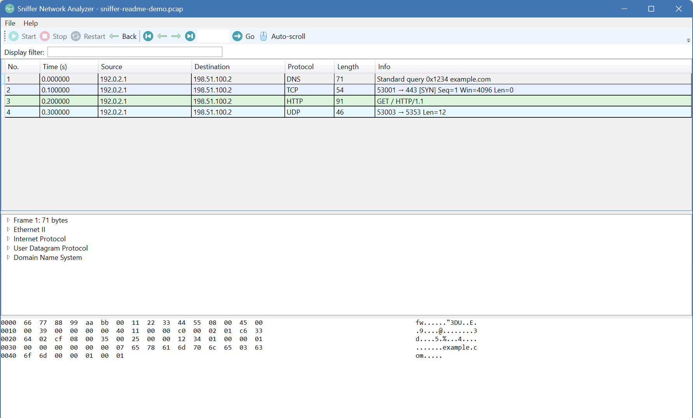

# Sniffer 2.0

Ứng dụng Windows để bắt và phân tích gói tin mạng, hoặc mở tệp capture có sẵn.

## Lưu ý

Ứng dụng sử dụng .NET 10 và SharpPcap. Để bắt gói tin trực tiếp, cần cài [Npcap](https://npcap.com/#download); quyền truy cập adapter phụ thuộc cấu hình Npcap và quyền của người dùng.

## Hướng dẫn sử dụng

1. Chọn một adapter ở màn hình đầu để bắt gói tin, hoặc chọn **Open capture file** để mở tệp PCAP/PCAPNG mà không cần adapter.
2. Dùng **Start**, **Stop** và **Restart** để điều khiển phiên bắt. **Back** quay về màn hình chọn adapter.
3. Chọn một gói trong danh sách để xem các tầng giao thức và dữ liệu hex/ASCII. Các nút điều hướng chuyển giữa các gói đang hiển thị; **Auto-scroll** tự cuộn đến gói mới.
4. Dùng **File → Open capture** và **File → Save capture** để mở hoặc lưu toàn bộ gói tin. Phần mở rộng `.pcap` hoặc `.pcapng` quyết định định dạng khi lưu.

PCAPNG hỗ trợ các khối packet có timestamp và nhiều loại link-layer. Các khối simple packet không có timestamp, độ chính xác dưới nano giây và khối quá 64 MiB hiện không được hỗ trợ; ứng dụng sẽ báo lỗi thay vì bỏ qua. Khi lưu, dữ liệu gói, thời gian, độ dài và loại link-layer được giữ lại, nhưng các metadata/ghi chú khác của PCAPNG không được giữ. Nếu capture có nhiều loại link-layer, hãy lưu dưới dạng PCAPNG.

Danh sách hiển thị số thứ tự, thời gian tương đối, địa chỉ, giao thức, độ dài và thông tin gói. Chọn một gói để xem các tầng và dữ liệu hex/ASCII. Giao diện phân tích Ethernet, ARP, IPv4/IPv6, TCP, UDP, ICMP, DNS và HTTP cơ bản; DNS/HTTP được nhận diện trên dữ liệu từng gói, không ghép lại luồng TCP hay giải mã lưu lượng mã hóa.

Trong vùng dữ liệu, nhấn một byte hexadecimal để tô sáng byte và ký tự ASCII tương ứng. Mỗi dòng chứa tối đa 16 byte; các byte ngoài vùng ASCII in được hiển thị bằng dấu chấm, không phải văn bản đã giải mã từ lưu lượng mã hóa.

Bộ lọc hiển thị hỗ trợ các tên `ip`, `ipv6`, `arp`, `tcp`, `udp`, `icmp`, `icmpv6`, `dns`, `http`, cùng `ip.addr == <địa chỉ>`, `tcp.port == <cổng>`, `udp.port == <cổng>`, toán tử `&&`, `||` và dấu ngoặc. Ví dụ: `udp.port == 53 && ip.addr == 192.0.2.1`. Đây là tập con cú pháp Wireshark; lỗi cú pháp được hiển thị cạnh bộ lọc.

## Giao diện

*Giao diện phân tích với dữ liệu gói tin giả lập; thanh trạng thái được cắt khỏi ảnh.*

## Yêu cầu

- Windows; .NET 10 Desktop Runtime nếu chạy bản build không tự chứa runtime.
- .NET 10 SDK nếu cần build từ mã nguồn.
- Npcap để bắt gói tin trực tiếp.

Workflow GitHub Actions **Build Windows installer** tạo installer Windows x64 tự chứa .NET và tải lên dưới dạng artifact `Sniffer-Setup-win-x64` khi workflow chạy thành công. Npcap không được đóng gói hoặc tự động cài đặt: sau khi cài, người dùng có thể mở trang Npcap chính thức và tự cài đặt theo giấy phép của Npcap. Mở tệp capture không yêu cầu Npcap.

## Tải về

Truy cập phiên bản release của ứng dụng tại link này [https://github.com/quocthang0507/Sniffer/releases](https://github.com/quocthang0507/Sniffer/releases)

## Tác giả

Nếu có góp ý cho ứng dụng này, hoặc muốn sử dụng lại, vui lòng liên hệ qua email sau:
La Quốc Thắng - quocthang_0507@yahoo.com.vn